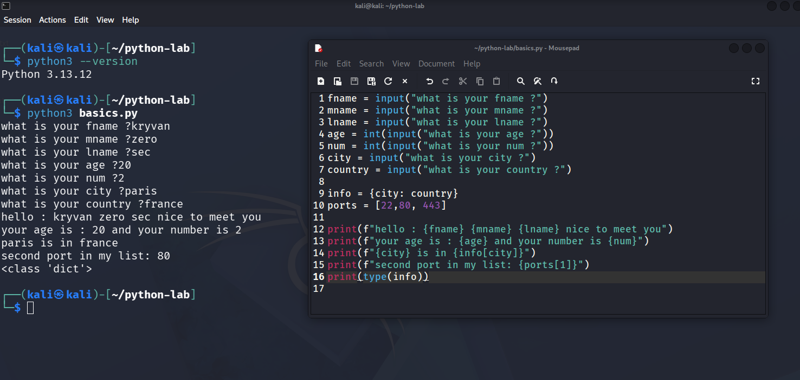

# Python Basics: My First Notes (Week 1) Day 6

> Goal: understand the first building blocks of Python before writing any security script.
> Environment: Kali Linux (VirtualBox), Python 3, Mousepad, terminal.

## Why Python for cybersecurity?

- **Fast to write:** a small tool takes a few lines.
- **Ready-made libraries:** `socket`, `requests`, `scapy`, `pwntools`.
- **Many security tools are written in Python**, so I can read and change them, not only run them.
- It is not the only language I need: Bash, PowerShell and C come later.

## 1. Variables

A variable is a **name that points to a value** in memory. It is not a box that holds the data.

```python
target = "192.168.1.10"
port = 22
```

Naming rules:

1. Can start with a letter or underscore `_`
2. Cannot start with a number or a special character
3. Can contain letters, numbers and `_` only
4. Case sensitive: `Name` is not `name`
5. Cannot be a reserved keyword (for example `class`). Check with `help("keywords")`

## 2. Data types

| Type | Example | Meaning |
|---|---|---|
| `int` | `22` | whole number |
| `float` | `100.9` | decimal number (uses a dot, not a comma) |
| `str` | `"ssh"` | text |
| `list` | `[22, 80, 443]` | ordered items, can be changed |
| `tuple` | `(22, 80)` | ordered items, cannot be changed |
| `dict` | `{22: "ssh"}` | key -> value pairs |
| `bool` | `True` / `False` | yes or no |

Check any type with `type(x)`.

## 3. input() and print()

- `input()` asks the user and **always returns a string**, even if the user types a number.
- To get a number, convert it: `int(input("..."))`.
- `print()` shows output on the screen.

## 4. f-strings

Put `f` before the quotes and write variables inside `{ }`:

```python
print(f"Target {target} uses port {port}")
```

## 5. Lists and dictionaries (what I learned by doing)

- List counting starts from **0**: `ports[0]` is the first item.
- A dictionary is read **by key, not by value**: `info[key]` gives the value.
- A user cannot give me a dictionary through `input()`. I ask for the values, then I build the dictionary in code.

## Practical example

File: [`scripts/basics.py`](../scripts/basics.py)

```python
fname = input("what is your fname ? ")
mname = input("what is your mname ? ")
lname = input("what is your lname ? ")
age = int(input("what is your age ? "))
num = int(input("what is your num ? "))
city = input("what is your city ? ")
country = input("what is your country ? ")

info = {city: country}
ports = [22, 80, 443]

print(f"hello : {fname} {mname} {lname} nice to meet you")
print(f"your age is : {age} and your number is {num}")
print(f"{city} is in {info[city]}")
print(f"second port in my list: {ports[1]}")
print(type(info))
```

Run it:

```bash
python3 basics.py
```

Output:

```
hello : nimo ziko baki nice to meet you
your age is : 28 and your number is 2
paris is in france
second port in my list: 80
<class 'dict'>
```

Screenshot from Kali: 

## Errors I hit and how I fixed them

| Error | What it means | My fix |
|---|---|---|
| `command not found: mouspad` | typo in the command | typed `mousepad` |
| `SyntaxError: '(' was never closed` | a bracket is missing | closed the bracket |
| `TypeError: input expected at most 1 argument, got 2` | `input()` takes one message only | one text inside `input()` |
| `ValueError: dictionary update sequence element #0 has length 1; 2 is required` | `dict()` got a string, but needs key-value pairs | removed `dict(input())`, built the dict with `{ }` |
| `NameError: name 'city' is not defined` | I used a variable before creating it | created `city` in a line above |
| `KeyError: 'france'` | I searched the dictionary with a value, not a key | used `info[city]` |

Silent bug: I wrote `fname = ...` two times by mistake. The code ran, but the first name was overwritten with the wrong value. No error appeared, so **always read the output**, not only the errors.

## What I understood

I learned how to build simple programs with `print()` and `input()`. `input()` pauses the program and waits for the user to type a value, and it always returns a string. That is why I use `int(input(...))` when I need a number.

I learned that all data in Python is an object. A variable is only a name that points to a value stored in memory. Python is dynamically typed, so the same variable can hold `10` and later `"Hello"`. Variable names follow rules, and reserved words like `class` cannot be used as names.

For formatting text I use f-strings: I put `f` before the quotes, like `print(f"Hello {name}")`.

I also practiced `int`, `list` and `dict`. A list starts counting from 0, so `ports[1]` is the second item. A dictionary is read by key, not by value. My `dict(input())` failed because `input()` returns a string, and `dict()` needs key-value pairs. I fixed it by building the dictionary myself with `{city: country}`.

The most useful error for me was `KeyError`, because it taught me to search a dictionary by key. I also found a silent bug: I used `fname` twice, the code ran, but it printed a wrong value. Now I always read the output, not only the errors.
- Why does `input()` return text?
- Why does `dict(input())` fail?
- What is the difference between a key and a value?

## Evidence

- [x] Code written by me in Kali (not copied)
- [x] Ran with `python3 basics.py`
- [x] Screenshot added
- [ ] Teach-back done (explained without notes)

## Next step

`subnet_helper.py`: a script that takes an IP/CIDR with `input()` and prints Network, Broadcast and Usable Hosts using my own logic.
